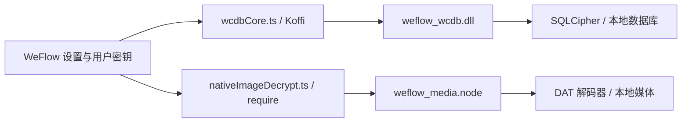

# WeFlow 原生解密组件设计（Windows）

## 目标与交付形态

为用户自己持有密钥和本地数据的场景提供两种可插拔组件：

| 设置项 | 文件 | 加载方式 | 职责 |
| --- | --- | --- | --- |
| `wcdbLibPath` | `weflow_wcdb.dll` | Koffi / C ABI | 用提供的数据库密钥打开本地 `session.db`，查询会话、消息和关联数据库 |
| `imageNativeAddonPath` | `weflow_media.node` | Electron `require()` / Node-API | 用提供的 XOR/AES 密钥解码 `.dat` 媒体，返回 `Buffer` 与格式信息 |

`.node` 在 Windows 上也是原生动态库，但必须带 Node-API 注册入口；普通 C ABI DLL 不能直接填入 `imageNativeAddonPath`。两个文件可共用一个内部 Rust 解码库，分别编译成 C ABI DLL 和 Node-API 插件。首版面向 Windows x64，与当前 Electron 进程架构一致；跨平台时再生成 `.so` / `.dylib`。



组件只消费调用方传入的密钥和路径。密钥获取属于现有 `keyProviderService.ts` 或用户配置的职责；DLL 不扫描其他进程内存，也不上传数据库、媒体或密钥。

## 1. WCDB DLL

### ABI 与实际加载要求

统一使用 `extern "C"`、Windows x64 C 调用约定、UTF-8 NUL 结尾的 `char*`、`int32_t` 状态码和 `int64_t` 不透明句柄。成功返回 `0`；失败返回非零错误码。所有 `char**` / `void**` 输出在失败前先设为 `NULL`，成功时由 DLL 分配，调用方只通过 `wcdb_free_string` 释放。不得跨 DLL 边界直接释放 Rust、C++ 或 SQLCipher 的内部指针。

接口文档称只有 `wcdb_open_account` 必需，但当前 `electron/services/wcdbCore.ts` 的 `initialize()` 对下列 **27 个**符号直接绑定，少任意一个都会使初始化失败：

```text
wcdb_init                         wcdb_shutdown
wcdb_open_account                 wcdb_close_account
wcdb_free_string                  wcdb_get_sessions
wcdb_get_messages                 wcdb_get_message_count
wcdb_get_message_by_svrid         wcdb_get_display_names
wcdb_get_avatar_urls              wcdb_get_group_member_count
wcdb_get_group_members            wcdb_get_message_tables
wcdb_get_message_meta             wcdb_get_contact
wcdb_get_message_table_stats      wcdb_get_aggregate_stats
wcdb_open_message_cursor          wcdb_fetch_message_batch
wcdb_close_message_cursor         wcdb_get_logs
wcdb_exec_query                   wcdb_get_emoticon_cdn_url
wcdb_list_message_dbs             wcdb_list_media_dbs
wcdb_get_message_by_id
```

因此首版 DLL 要么实现这些导出，要么先调整 `wcdbCore.ts` 把暂不支持的绑定改为可选，并保护对应调用点。仅导出 `wcdb_open_account` 的 DLL 在当前版本无法使用。其余接口按实际调用路径逐步增加；返回虚假的空数组会把“尚未实现”伪装为“没有数据”，应返回明确的 `UNSUPPORTED` 错误码。

### 打开数据库与句柄

`wcdb_open_account(path, key, outHandle)` 收到的是 **`session.db` 的完整路径**，不是账号目录；`key` 是 WeFlow 传入的十六进制字符串。核心流程：

1. 验证路径、hex 字符及密钥长度；将 hex 解成字节，不在日志中输出原值。
2. 使用 SQLCipher 的只读连接打开 `session.db`，应用与该数据库格式匹配的 cipher 参数和密钥；通过读取 `sqlite_master` 验证解密是否成功。具体 cipher 兼容参数必须用目标数据库样本确认，不能仅凭文件扩展名猜测。
3. 由 `session.db` 定位同一 `db_storage` 下的消息、联系人和媒体数据库；只接受解析后仍在该账号目录内的路径，避免把任意输入拼成 SQL 或文件路径。
4. 生成正数句柄，在并发安全的句柄表中保存连接、账号根目录和游标。失败时关闭已打开的连接并清零临时密钥。
5. `wcdb_shutdown` 关闭全部句柄和游标，支持重复调用；`wcdb_close_account` 关闭单句柄，即使当前 JS 主要调用 `shutdown`。

读操作默认只读。由 DLL 自己构建的查询使用绑定参数；表名等标识符先由 `sqlite_master` 枚举并校验，再进行安全引用。`wcdb_exec_query` 的现有 ABI 只传入 SQL 字符串，没有参数数组，所以 DLL 应用 `sqlite3_prepare_v3` 检查只含一条语句，并用 `sqlite3_stmt_readonly` 与 authorizer 限定为只读操作；若要彻底消除调用方拼接参数，需扩展 ABI 和 `wcdbCore.ts`。未来支持写入时应独立设计备份与事务。实时数据库使用 WAL 时应保留对应 sidecar 文件并处理锁，不使用会忽略 WAL 的 `immutable=1` 模式。

### 返回数据与游标

- 会话、消息等集合接口成功时返回 UTF-8 JSON **数组**；计数接口通过 `int32_t*` 返回值。JSON 字段名称以 `wcdbCore.ts` 和 `chatService.ts` 的解析点为准，例如会话 `username` / `sort_timestamp`、消息 `local_id` / `server_id` / `create_time` / `local_type` / `message_content` / `compress_content`。为兼容旧调用方，消息正文也同时返回 `content`。
- `server_id` 等 64 位标识符建议用 JSON 字符串，避免 JavaScript 的 53 位整数精度限制。当前 `parseMessageJson()` 对部分 `server_id` 数字做了补救，但插件直接输出字符串更稳妥。
- `wcdb_open_message_cursor` 创建属于账号句柄的游标；`fetch` 只推进自己的游标并返回 `outHasMore`；`close` 可重复调用。设置单次批量上限，防止巨大内存分配。
- `wcdb_get_logs` 输出 JSON 字符串数组，仅记录错误码、阶段和耗时，不记录密钥、完整消息内容或媒体字节。

打开数据库沿用 UI 已识别的错误码：`-3` 找不到 `session.db`、`-4` 密钥或 cipher 参数不匹配/打开失败、`-5` schema 无法读取、`-6` 未找到兼容会话表。其他新错误码单独分配在 `-4100` 段，例如参数错误、无效句柄、不支持的功能及资源限制，避免和当前 `wcdbCore.ts` 中 `-1`、`-7` 等已有含义冲突；新码在 UI 没有映射时会显示通用错误文案。

## 2. 媒体 `.node` 插件

导出 `decryptDatNative(inputPath, xorKey, aesKey?)`，成功返回 `{ data: Buffer, ext: string, isWxgf: boolean, version?, aesSize?, xorSize?, rawSize?, flag? }`；失败抛出带简短错误码的异常，由当前调用方转换为 `null`。使用 Node-API / `napi-rs`，从而不依赖特定 V8 ABI。插件只读取输入文件，不直接写入缓存或解密结果。

与 `imageDecryptService.ts` 现有 JS 路径保持一致的首版解码规则：

1. 输入已是 GIF/PNG/JPEG/WebP 时原样返回。
2. 对非 V2 头，尝试逐字节 `byte ^ (xorKey & 0xff)`，再按文件魔数确认结果；这覆盖当前 V1 / V3 式 XOR 路径。
3. 对头部 `07 08 56 32 08 07` 的 V2 格式，读取偏移 6、10 处的 little-endian `aesSize`、`xorSize`；按当前代码的 16 字节对齐规则处理 AES 段。取调用方 `aesKey` ASCII 字节的前 16 字节，AES-128-ECB 解密并严格检查 PKCS#7 padding；拼接中间原始段和末尾 XOR 解码段。
4. 所有长度在分配或切片前检查：头至少 15 字节、分段大小非负且不越界、AES 密文块长度为 16 的倍数、输出不超过设定上限。格式不匹配时给出错误，不把未验证数据当作图片。
5. 解码结果以魔数识别扩展名；如果是 `wxgf` 容器，返回原始解码字节并设 `isWxgf: true`，交给现有 `unwrapWxgf()` 流程。不能把 `wxgf` 直接标成 `jpg`。MP4 等媒体只在有对应样本和消费路径验证后加入。

`encryptDatNative` 是可选接口。首版只做解密；若增加回写，应先定义与原格式完全一致的填充、分段和元数据规则，并用 `decrypt(encrypt(x))` 与真实文件往返验证。

当前 `imageDecryptService.ts` 在插件失败后仍会走 JS 解密 fallback，与接口说明中“无降级实现”的总述不一致。若产品要求完全依赖第三方插件，需要另行调整该调用点；本设计按当前运行代码描述行为。

## 工程结构与验证

建议 Rust workspace：`core/` 放密钥处理、DAT 解析、错误类型；`wcdb-ffi/` 输出 `cdylib` 并通过 SQLCipher FFI 管理数据库；`media-napi/` 输出 `.node`。SQLCipher 依赖可以静态链接，减少用户配置 DLL 搜索路径的成本；需核对所选发行方式的许可证与编译选项。构建产物分别配置到上述两个设置项，不打包进 WeFlow 本体。

验收顺序：

1. 用 `dumpbin /exports` 或等价工具检查 27 个必需符号，Koffi 加载后调用 `init → open → sessions → messages → free → shutdown`。
2. 用自建 SQLCipher 测试库验证正确/错误密钥、损坏文件、空结果、并发句柄、游标结束、重复关闭和错误路径；再用用户授权的实际账号样本确定 cipher 参数及表结构。
3. 用非敏感媒体夹具覆盖原样图片、XOR、V2 AES+XOR、错误 padding、截断头、畸形长度、`wxgf` 和大文件；对照当前 JS 路径的输出字节。
4. 在 WeFlow 设置中分别选中 `.dll` 和 `.node`，验证会话列表、消息分页和图片显示。性能目标与最大文件大小由真实样本测量后确定。

### 实施前仍需确认的数据

数据库部分需要一份已获授权的脱敏 `session.db` 及相关数据库结构、对应可用密钥和数据库版本，或现有 SQLCipher 参数/表结构文档；仅凭公开的 ABI 无法准确实现查询。媒体部分需要覆盖目标版本的 `.dat` 夹具及预期明文字节，才能确认 V2 外的格式和 `wxgf` 行为。
